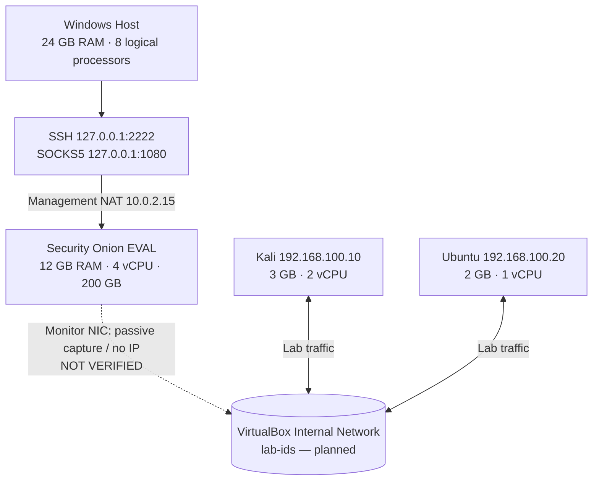

# Security Onion A32 Lab

[](#mục-tiêu)
[](https://docs.securityonion.net/en/3/main/)
[](https://www.virtualbox.org/)

> **Đề tài A32 — Nghiên cứu Security Onion:** Tìm hiểu các chức năng, nguyên lý, triển khai, demo và hệ sinh thái của giải pháp giám sát/phát hiện xâm nhập mạng.  
> **Security Onion 3.3.0 · VirtualBox · NIDS/NSM · SOC investigation**

**Tiến độ xác nhận ngày 17/10/2026:** ISO/EVAL đã cài thành công; `so-status -q` đã trả `0`; Nginx/SOC phản hồi HTTPS; Windows kết nối vào SOC qua **VirtualBox NAT → SSH Key → SOCKS5 → Firefox**. **Chưa xác nhận:** card Monitor, Kali ↔ Ubuntu, Zeek events từ mạng lab, demo tấn công. Xem [trạng thái dự án](PROJECT_STATUS.md).

> **Phạm vi kỹ thuật:** Demo sử dụng Community/EVAL để **phát hiện, giám sát và điều tra**; không tuyên bố Security Onion là thiết bị IPS inline ngăn chặn lưu lượng. Tính năng thương mại Security Onion Pro được khảo sát trên tài liệu, không giả định có giấy phép Pro.

## Mục tiêu

| Yêu cầu học phần | Kết quả thực hiện | Tài liệu |
|---|---|---|
| Tìm hiểu tính năng | Suricata, Zeek, SOC Alerts/Hunt/PCAP/Cases | [Overview](docs/01-overview.md), [Ecosystem](docs/07-ecosystem.md) |
| Nguyên lý, triển khai, tích hợp | Mô hình EVAL, network interfaces, luồng dữ liệu và quy trình ISO | [Architecture](docs/02-architecture.md), [Installation](docs/03-installation.md) |
| Demo tính năng chính | ICMP/HTTP visibility → quét mạng → web testing → triage/PCAP | [Runbook](docs/05-demo-runbook.md), [Scenarios](scenarios/) |
| Hệ sinh thái | Security Onion Pro, Zeek, Suricata, Elastic, Strelka, tích hợp | [Ecosystem](docs/07-ecosystem.md), [Limits](docs/08-scope-limitations.md) |

## Kiến trúc



**Đã chạy thực tế:** Adapter 1 NAT, IP guest quản trị `10.0.2.15`; Windows SSH host port `2222` → guest port `22`, HTTPS host port `8443` → guest `443`; nguồn NAT `10.0.2.2` đã được thêm vào nhóm `analyst` của Security Onion. **Chưa chạy thực tế:** mô hình mạng `lab-ids` và hai VM tấn công/nạn nhân. Các IP này là địa chỉ lab, có thể thay đổi theo môi trường.

| Node | RAM | vCPU | Disk | Vai trò |
|---|---:|---:|---:|---|
| Security Onion EVAL | 12 GB | 4 | 200 GB | Management + giám sát thụ động |
| Kali CLI/XFCE | 3 GB | 2 | 40 GB | Sinh traffic kiểm thử (dự kiến) |
| Ubuntu Server | 2 GB | 1 | 30 GB | Web victim (dự kiến) |
| Windows Host | ~7 GB còn lại | 8 logical CPU chia sẻ | — | VirtualBox, Firefox, SSH tunnel |

Bộ nhớ là phân bổ đề xuất, không phải kết quả đo tiêu thụ. Security Onion EVAL theo tài liệu hãng yêu cầu tối thiểu 4 CPU/8GB/200GB/2 NIC và không hỗ trợ remote Elastic Agent; không chạy Redis/Logstash trong cấu hình EVAL chuẩn. [Hardware](https://docs.securityonion.net/en/3/main/hardware/), [Architecture](https://docs.securityonion.net/en/3/main/architecture/).

## Bắt đầu nhanh

**Bạn muốn dựng lại SO từ đầu?** [Cài đặt ISO chi tiết](docs/03-installation.md) → [Nhật ký cài đặt đã xác minh](docs/10-verified-setup.md) → [Xử lý lỗi](docs/06-troubleshooting.md).

**Bạn đã có VM như trong dự án?**

1. Bật VM Security Onion, chờ dịch vụ khởi động. Không chạy lại `so-setup`.
2. Windows: SSH key + SOCKS tunnel (script hoặc task) — [hướng dẫn Windows chi tiết](docs/11-windows-ssh-socks.md).
3. Firefox profile dành riêng cho lab (SOCKS5 `127.0.0.1:1080`) → `https://10.0.2.15`.
4. Xác minh: `sudo so-status -q` trả `0`; [quick start sau reboot](docs/13-daily-workflow.md).
5. Kiểm tra card Monitor **trước khi thay đổi Adapter 2**: [bước tiếp theo](docs/12-monitoring-next.md).

## Khắc phục đã thực hiện thành công

| Triệu chứng | Cách xác định / kết quả |
|---|---|
| Setup Docker pull bị `Connection refused` | Kiểm tra `sosetup.log`, registry, chạy lại Setup từ ISO khi mạng ổn; **không kết luận chính xác nguồn lỗi ban đầu từ một dòng 403** |
| Ngỡ Setup treo do Save State | Theo dõi log/Salt; một lần kiểm tra cho `Succeeded: 38`, `Failed: 0`; sau đó `so-status -q = 0` |
| Windows mở `https://127.0.0.1:8443` bị treo | TCP 8443 có listener, packet từ `10.0.2.2` tới VM nhưng không SYN-ACK; xác định firewall đang chặn nguồn |
| Firewall SOC | `sudo so-firewall includehost analyst 10.0.2.2`; cấu hình được ghi vào pillar, sau khi áp dụng đã truy cập HTTPS và nhận `307` |
| Mở web SOC từ localhost bị redirect | Redirect về `https://10.0.2.15/`; dùng SSH SOCKS5 + Firefox vào **địa chỉ gốc** thay vì sửa `url_base` vội |
| Copy/paste lệnh trong VirtualBox khó | Dùng SSH Windows `127.0.0.1:2222` + key `ed25519` |
| Muốn tự kết nối sau khi bật VM | Dùng [`windows/auto-tunnel.ps1`](windows/auto-tunnel.ps1) với config local và Task Scheduler |

Chi tiết bằng chứng và giới hạn suy luận: [10 — Verified Setup](docs/10-verified-setup.md), [11 — Windows access](docs/11-windows-ssh-socks.md). **Tuyệt đối không upload ảnh chứa mật khẩu, cookies hoặc log nhạy cảm vào repository public.**

## Kịch bản demo / trạng thái

| ID | Mục tiêu | Tình trạng |
|---|---|---|
| TC-01 | `tcpdump` nhìn thấy lưu lượng Kali ↔ Ubuntu; Zeek metadata | ⏳ Chưa chạy |
| TC-02 | Quét dịch vụ trong mạng cô lập và đối chiếu Zeek/Suricata | ⏳ Chưa chạy |
| TC-03 | SQL Injection trên OWASP Juice Shop, đánh giá HTTP/PCAP/Alerts | ⏳ Chưa chạy |
| TC-04 | Alerts → Hunt → PCAP → Cases, lập bằng chứng | ⏳ Chưa chạy |
| TC-05 | Mô phỏng beacon lành tính, phân tích chu kỳ | ⏳ Tùy chọn |

> Zeek nhìn thấy metadata **không bảo đảm** Suricata tạo alert. Mọi kết quả cần ghi thời gian, dữ liệu và trạng thái thực tế. [Mẫu báo cáo](report/results-template.csv).

## Cấu trúc repository

```text
security-onion-a32-lab/
├── .github/                  # Docs CI, issue và PR template
├── configs/                  # Cấu hình minh họa, không có secrets
├── diagrams/                 # Topology và dataflow (Mermaid)
├── docs/                     # Lý thuyết, deployment log, setup, troubleshooting
├── evidence/                 # Quy chuẩn bằng chứng, mẫu ca
├── report/                   # Dàn ý, checklist, results CSV
├── scenarios/                # Các case kiểm thử trên lab cô lập
├── scripts/                  # Scripts thu thập thông tin chỉ đọc và repo checks
├── windows/                  # SSH SOCKS auto-connect, kiểm tra, hướng dẫn
├── README.md
├── PROJECT_STATUS.md
├── SECURITY.md
└── PUBLISH_TO_GITHUB.md
```

## Lộ trình tiếp theo

- [x] ISO/EVAL Setup + service status
- [x] NAT/SSH/HTTPS/SOCKS và Firefox truy cập SOC
- [ ] Xác minh `enp0s8`/`bond0` được cấu hình monitoring đúng
- [ ] Chuyển mạng lab sang `Internal Network: lab-ids` một cách có kiểm soát
- [ ] Tạo Kali + Ubuntu, xác nhận `tcpdump` hai chiều
- [ ] Truy vấn Zeek/Suricata trên SOC, thu thập bằng chứng
- [ ] Demo + báo cáo theo 4 yêu cầu giảng viên

## Tài liệu gốc & pháp lý

Tài liệu chính thức: [Security Onion 3](https://docs.securityonion.net/en/3/main/) · [Hardware](https://docs.securityonion.net/en/3/main/hardware/) · [VirtualBox](https://docs.securityonion.net/en/3/main/virtualbox/) · [Firewall](https://docs.securityonion.net/en/3/main/firewall/) · [Salt](https://docs.securityonion.net/en/3/main/salt/) · [ISO Installation](https://docs.securityonion.net/en/3/main/installation/). Danh sách đầy đủ: [References](docs/09-references.md).

Mọi hoạt động kiểm thử chỉ áp dụng trên máy ảo **do nhóm kiểm soát** và mạng lab cô lập. Repository học thuật **không liên kết/chứng thực bởi Security Onion Solutions**. Không đăng tải ISO, disk VM, private key, tài khoản hoặc PCAP có dữ liệu riêng tư. [Security policy](SECURITY.md).
