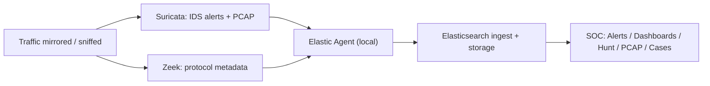

# 02 — Kiến trúc EVAL và topology VirtualBox

## Tài nguyên cho Host 24 GB / 8 logical processors

| Node | RAM | vCPU | Disk |
|---|---:|---:|---:|
| Security Onion EVAL | 12 GB | 4 | 200 GB (dynamically allocated) |
| Kali Linux | 3 GB | 2 | 40 GB |
| Ubuntu Server | 2 GB | 1 | 30 GB |
| Host còn lại | ~7 GB | shared | tùy SSD |

Tối thiểu EVAL từ vendor: 4 core, 8 GB RAM, 200 GB disk, 2 NIC. Không dùng Standalone vì nó đòi tối thiểu 24 GB RAM **cho riêng node**, chưa tính các VM khác. Đảm bảo ổ Host thật còn nhiều dung lượng vì disk dynamically allocated vẫn sẽ tăng kích thước.

## Lược đồ logic

Đọc [`../diagrams/network-topology.mmd`](../diagrams/network-topology.mmd) hoặc Mermaid trong [`../README.md`](../README.md).

| VM | NIC | Mode | Địa chỉ |
|---|---|---|---|
| Security Onion | Adapter 1 | NAT / Management | DHCP (IP thực tế do VirtualBox cấp) |
| Security Onion | Adapter 2 | Internal Network `lab-ids` / Monitor | **Không IP** |
| Kali | Adapter 1 | Internal Network `lab-ids` | 192.168.100.10/24 (đề xuất) |
| Ubuntu | Adapter 1 | Internal Network `lab-ids` | 192.168.100.20/24 (đề xuất) |

- Promiscuous Mode của NIC monitor: `Allow VMs` hoặc `Allow All` khi cần; kiểm chứng bằng packet capture, không mặc định giả định mirrored traffic.
- NIC NAT dành cho **management**. Cân nhắc NAT Port Forwarding Host `127.0.0.1:8443` → guest `443` nếu cần mở web SOC từ Host. Cấu hình cụ thể còn phụ thuộc firewall source IP mà guest quan sát.
- Không gán gateway ra Internet cho mạng `lab-ids`; chỉ bật NAT tạm thời cho Kali/Ubuntu để cập nhật/cài gói và tắt lại khi demo.
- Không thay đổi hostname khi Security Onion đã Setup xong nếu không có quy trình hỗ trợ.

## Pipeline EVAL

**Quan trọng:** Đây là sơ đồ khái niệm, không biểu diễn chi tiết mọi đường PCAP trên disk. EVAL không vận hành Logstash/Redis. Dữ liệu PCAP do Suricata ghi trên node; giao diện PCAP có thể liên kết từ event.

## Tiêu chí nghiệm thu kiến trúc

1. Host mở SOC từ mạng Management (không mở ingress với `0.0.0.0/0`).
2. Kali ping được Ubuntu **qua IP Internal Network**.
3. `sudo tcpdump -ni <monitor_interface> 'host 192.168.100.10 and host 192.168.100.20'` quan sát được request và reply.
4. Từ Hunt/Dashboards tìm thấy metadata tương ứng sau thời gian ingest.

## Rủi ro

| Rủi ro | Hậu quả | Cách kiểm soát |
|---|---|---|
| CPU host bị bão hòa | SOC chậm, packet loss | Chạy số VM cần thiết, giới hạn tải test, giám sát Host CPU |
| Host thiếu chỗ trống | Lỗi cài đặt/Elasticsearch | Kiểm tra `df -h` guest và dung lượng SSD Host |
| Promiscuous không thấy traffic | Không có event | Xác minh bằng `tcpdump`; cân nhắc topology routed/TAP khác |
| NAT forwarding + firewall | SOC không truy cập | Kiểm tra source IP thực tế, chỉ mở nhóm `analyst` cho IP đúng |
| HTTPS mã hóa | Không thấy HTTP payload | Chỉ dùng HTTP rõ ở mạng lab khi mục tiêu là nội dung request |

**Nguồn:** [Hardware](https://docs.securityonion.net/en/3/main/hardware/), [VirtualBox](https://docs.securityonion.net/en/3/main/virtualbox/), [Architecture](https://docs.securityonion.net/en/3/main/architecture/), [PCAP](https://docs.securityonion.net/en/3/main/pcap/).
